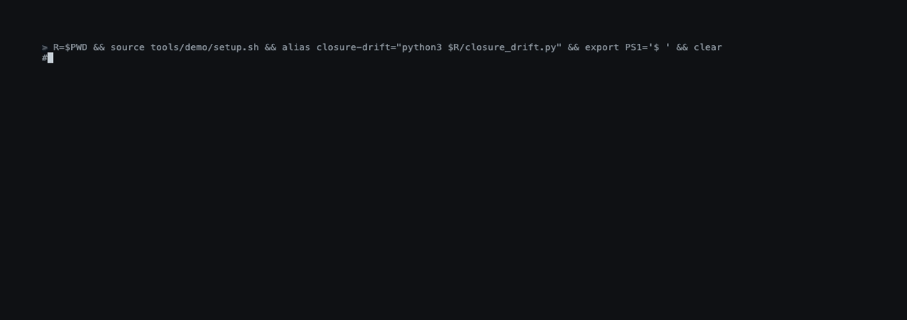

# closure_drift

A version label should name one state of your code. `closure_drift` checks that it does.
One Python file, no dependencies, read-only, no network.



## Try it

```bash
git clone -q https://github.com/luizfnsilva/closure_drift
python3 closure_drift/examples/demo.py                 # the three answers, on tiny repositories
python3 closure_drift/closure_drift.py /path/to/your/repo
```

Needs Python 3.9+ and git. Before you tag: `--would-tag`. After you tag, before you push: `--tag v1.2.0`.

In CI: [`docs/CI.md`](docs/CI.md). With an agent: the skill in
[`skills/closure-drift/`](skills/closure-drift/SKILL.md), or the MCP server in [`integrations/`](integrations/).

## What it says

| verdict | exit | |
|---|---|---|
| `clean` | 0 | every version label names one state of the code |
| `drift` | 1 | a label names more than one |
| anything else | 2 | nothing decided; the report says why |

With `--tag`: `tag_matches` (0) or `tag_mismatch` (1).

```
$ git clone -q https://github.com/psf/requests && cd requests
$ closure-drift --compare v2.16.0 v2.16.1
...
DIFFERS UNDER ONE LABEL: both declare 2.16.0, and the code differs
in 2 path(s). If both were published, that label names two things.
```

Every report records the commit it measured and the hash of the checker, so anyone can run it again
and get the same answer.

## Limits

It reads git, not a package index: it shows what the tags contain, not which commit a published
package was built from. It attests and signs nothing. More: [`SCOPE.md`](SCOPE.md).

## More

- [`docs/START.md`](docs/START.md): does it fit, which mode, what the answer means, what next
- [`docs/USAGE.md`](docs/USAGE.md): every option, the GitHub Action, pre-commit, agents, tests
- [`RESULTS.md`](RESULTS.md): measurements by others, including results that are not clean
- [`docs/FAILURES.md`](docs/FAILURES.md): every failure of the tool found so far
- [`SCOPE.md`](SCOPE.md) · [`THREAT_MODEL.md`](THREAT_MODEL.md) · [`CHANGELOG.md`](CHANGELOG.md)
- The measurement record behind it: [10.5281/zenodo.21765404](https://doi.org/10.5281/zenodo.21765404)

Apache-2.0. Cite as [10.5281/zenodo.21763931](https://doi.org/10.5281/zenodo.21763931).
